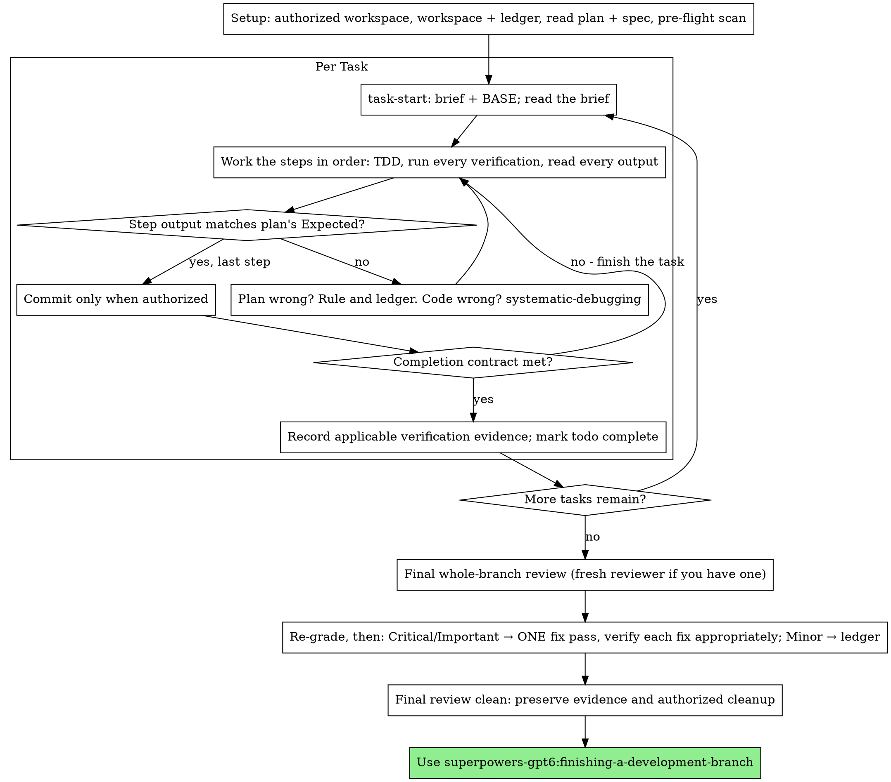

# Executing Plans

**Scope:** This is an opt-in workflow. [Selection and authority](../using-superpowers/SKILL.md) apply, including supporting steps of an accepted workflow.

Execute the plan yourself, task by task, in this session: no implementer
subagent per task, no reviewer per task. One fresh-context review of the
whole branch at the end.

**Why inline:** Subagent-driven development pays for a fresh implementer
and a fresh reviewer on every task, each re-reading the codebase from zero.
Inline execution pays for one context (yours) plus one reviewer at the end.
What it gives up is a fresh context per task and a second pair of eyes per
task. This skill keeps what those two things bought, by other means: the
brief is the spec, the ledger is your memory, TDD is the per-task gate, and
the final reviewer is the second pair of eyes.

**Core principle:** The plan already did the thinking. Execute it exactly,
verify each step with evidence appropriate to the artifact, and leave a
record that survives your own forgetting.

**Narration:** Follow the host's progress-update cadence with concise findings.
The ledger carries the detailed record.

**Continuous execution:** Do not pause to check in with your human partner
between tasks. They chose inline execution to spend less, not to answer
"should I continue?" after every task. Execute all tasks from the plan
without stopping.

System/developer instructions and host permissions remain binding. Current
user instructions and established preferences govern skill defaults. Preserve
accepted design, plan, and execution gates. Historical plans and examples do
not grant new authority. Clarify missing decisions and pause dependent work
only; continue clear, independent authorized tasks. Quote and link a skill
instruction when it requires a pause.

Record routine implementation decisions in the plan ledger and continue.
Honor already authorized actions without asking again. Ask before an action
whose scope or authority is missing, after preparing the reviewable result.

## When to Use

- You have a plan from superpowers-gpt6:writing-plans and your human partner
  chose inline execution at the handoff.
- Your harness has no subagent tool (see the per-platform references in
  `../using-superpowers/references/`). Never fabricate a dispatch; run
  the plan here.
- Tasks are mostly independent — the same precondition as
  superpowers-gpt6:subagent-driven-development.

A fully specified plan makes inline execution transcription plus testing:
it runs well on a mid-tier session model, and the one place the most
capable model earns its cost is the final review, which this skill
dispatches separately. Tell your human partner so when they choose inline.

Prefer superpowers-gpt6:subagent-driven-development when your human partner
wants a review gate on every task, or when the plan is long enough that
its later tasks would run on a compacted context. Inline execution over a
long plan still works — the ledger is what makes it recoverable — but the
last tasks get the least of you.

## The Process

## Setup

Use the authorized checkout or inspect and reuse a suitable existing
workspace. If isolation is authorized, use superpowers-gpt6:using-git-worktrees
and prefer Codex native tools. Creating isolation, staging, committing,
publishing, or deleting work requires authorization; Git state is not consent.

On Windows, prefer the PowerShell 7+ commands in
[plan helpers](../subagent-driven-development/references/plan-helpers.md).
Resolve helper paths from the installed skill, not the project directory.

Conversation memory does not survive compaction. An inline executor that
loses its place re-implements tasks whose commits already exist — the same
failure as a controller re-dispatching them, paid for in your own context.
Track progress in a ledger file, not only in todos. Harness todos are a
live view; the ledger is the record.

On Windows, use the native PowerShell commands in
[plan helper commands](../subagent-driven-development/references/plan-helpers.md)
for setup and every later helper call.

The workspace and ledger are shared with superpowers-gpt6:subagent-driven-development
— same directory, same format — so a plan can change executors mid-flight
and the new one resumes from the same ledger.

- Each plan owns a workspace: at skill start, run
  `bash ../subagent-driven-development/scripts/sdd-workspace PLAN_FILE` — it
  prints the plan's git-ignored directory
  (`<repo-root>/.superpowers/sdd/<plan-basename>/`), home to every
  artifact for THIS plan: ledger, briefs, review packages. Another plan's
  directory is never yours to read or write.
- Check for this plan's ledger at `<workspace>/progress.md`. If its first
  line names your plan file, tasks with a `Task <N>: complete` line are
  DONE — do not redo them; resume at the first task without one. Their
  commits exist in git even when your context no longer remembers making
  them: after compaction, trust the ledger and `git log` over your own
  recollection. A ledger whose first line names a different plan file is
  another plan's progress: leave it and start your own, fresh.
- Create the ledger with its identity as the first line:
  `# SDD ledger — plan: <plan file path>`.
- `git clean -fdx` will destroy the workspace (it's git-ignored scratch);
  if that happens, recover from `git log`.

Read the plan once, note its context and Global Constraints, and create a
todo per task. If the plan names a Spec, read that too: the spec is the
authority the plan argues from, and conflicts inside the plan resolve
against it. A plan with no reachable spec gets a ledger note saying so —
rulings made without one are provisional.

Use superpowers-gpt6:test-driven-development for behavior changes within the
accepted TDD scope. Static artifacts need inspection or validation;
behavior-shaping skills need writing-skills evaluations.

Before Task 1, scan the plan for conflicts between tasks. The plan's
Interfaces blocks tell you where to look: for every task that consumes
what an earlier task produces, one ledger row — the two tasks, what one
produces against what the other consumes, and what you found. Tasks that
share nothing get no row; a plan whose tasks share nothing gets the single
line `Pre-flight: no shared interfaces`. Rule on each conflict a row
surfaces with the spec as the binding authority, record the ruling beside
its row, and start Task 1. Each task's own text is checked when you read
its brief, not here.

## The Task Loop

The Bash examples below require an explicit `bash` interpreter; use the
corresponding `.ps1` helper in PowerShell as linked above.

Everything you print, and every tool result, stays resident in your
context for the rest of the session. Redirect long test output to a file
in the workspace and read its tail; read a brief, not the whole plan.

### 1. Take the task

- Run this skill's `bash scripts/task-start PLAN_FILE N`. It prints the brief
  path and BASE (the commit the task's range is cut from) in one call.
  Read the brief for every task, including ones you remember from setup:
  what you remember is a summary, the brief has the exact values,
  signatures, and test cases.
- Mark the task's todo in_progress.

Every tool call is a turn that re-reads your whole context. Bookkeeping
rides along with work — a ledger append in the same call as the commit,
never in a call of its own.

### 2. Work the steps

Follow the accepted plan. For behavioral regressions under TDD, observe
the expected failure before the fix, then the passing result. For other
artifacts, use appropriate inspection, validation, or behavior evaluation.

Every step that runs a command has an `Expected:` line. Run the command,
read its output, and compare. Three outcomes:

- **Matches.** Next step.
- **The code is wrong.** Use superpowers-gpt6:systematic-debugging. Find the
  cause; never patch the symptom to make the step's output match.
- **The plan is wrong** — a step contradicts the spec, an interface from an
  earlier task doesn't match what this task consumes, a command that
  cannot work. Rule on the smallest change that satisfies the spec, ledger
  it as `Task <N>: Ruling: <finding> — <what you decided and why>`, and
  continue. The ruling is carried, not remembered: later tasks that touch
  the same interface read it from the ledger.

Commit only when authorized. A task that spans several commits
is fine; BASE is what the review range is cut from, never `HEAD~1`.

### 3. The completion contract

Before a task's ledger line, all of the following are true, with inspected
evidence for the current code, inputs, and environment:

- Every test the brief requires exists and has applicable passing results,
  and you read the output. Record a ruling for a required check that cannot
  run; do not claim that requirement is verified.
- The affected tests and required checks passed after the last relevant
  change. Reuse recorded evidence when nothing has invalidated it.
- Every `Expected:` line in the brief was compared against real output.
- Every deviation from the brief has a `Ruling:` line in the ledger.

**REQUIRED SUB-SKILL:** superpowers-gpt6:verification-before-completion governs
the claim. If any item is missing, the task is not complete: finish it.

### 4. Complete the task

Inspect the evidence against the completion contract. If every required
check has passing results covering the final code, inputs, and environment,
append the completion line directly without rerunning those checks. Include
the evidence file paths, commands, exit statuses, and covered code state:

`Task <N>: complete (commits <base7>..<head7>, tests: <command> → <result>)`

If a required check is missing or its results were invalidated, run that
check. When other completion requirements are already met, use this skill's
`bash scripts/task-done PLAN_FILE N BASE -- <test command>` for the final
required test run. It keeps the full output in the workspace, prints the
tail, and appends the completion line only if the command passes. Record
the other applicable evidence alongside that result. Do not duplicate an
identical run just to use the helper.

A failing run appends no completion line; investigate and report the
failure. Do not use a dummy passing command with `task-done` to manufacture
evidence. Once the completion contract is met and recorded, mark the todo
complete and take the next task.

## Final Review

After the last task, read [references/final-review.md](references/final-review.md)
and perform the required whole-change review. It covers uncommitted evidence,
reviewer contracts, severity, verification by artifact type, and fix scope.

## Finish

Before you delete anything, collect every ledger line containing
`Ruling:` into your final message under "Rulings I made", in the order you
made them, each with what it costs if wrong, and every `minor (deferred)`
line under "Deferred minors". Both lists are exhaustive. Your final
message is the only place the decisions you took on your human partner's
behalf — and the findings you chose not to act on — reach them.

Preserve the ledger, findings, and evidence until the handoff is complete.
Clean up only task-owned scratch when authorized and safely recoverable.
A Git commit does not preserve ignored or untracked evidence. Worktree
cleanup belongs to the native lifecycle in finishing-a-development-branch.

Use superpowers-gpt6:finishing-a-development-branch.

## Common Rationalizations

| Excuse | Reality |
|--------|---------|
| "I remember what Task N says" | You remember a summary. The brief has the exact values. Read it. |
| "The plan's code is right, skip watching the test fail" | A test you never saw fail proves nothing. It is one step. Run it. |
| "I'll run the full suite at the end instead of per step" | Per-step runs are how you learn which step broke it. At completion, inspect evidence for the final state; run missing or invalidated checks and reuse applicable results. |
| "The plan is wrong here, I'll just do the right thing" | Do the right thing and ledger the ruling. Unledgered deviation is a decision made in secret. |
| "I'll write the ledger lines after a few tasks" | Compaction does not wait for a convenient moment. One line per task, in the same message as the commit. |
| "Let me check in before the next task" | Continue authorized work; ask for missing decisions or authority only. Preserve accepted approval checkpoints. |
| "I read my own diff carefully; the final reviewer is redundant" | Same author, same blind spots. The reviewer is the only fresh context this run buys. |
| "Tests should pass, the change was trivial" | "Should" is not evidence. The contract requires the command and its output. |
| "Subagents are slow and expensive, I'll skip the final review too" | Inline already removed the per-task reviewers. One review of the whole branch is the floor, not the ceiling. |
| "The reviewer said Minor, so it's Minor" | The label graded the spec's silence. Grade what the person gets. Re-grade, then gate. |
| "The fix is obvious, no need to verify it" | Behavior regressions need RED→GREEN evidence; static artifacts need appropriate inspection or validation; instruction changes need behavior evaluation. A diff alone is not verification. |
| "I'll fix the minors too while I'm in there" | Every minor you fix adds a change and verification your partner did not ask for. Ledger them; your partner decides. |
